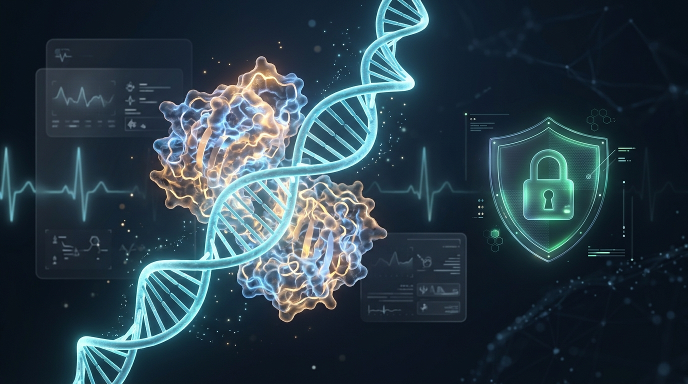

# 🩺 Bio-Atlas Medical Showcase

> **Sovereign Biomedical Intelligence, Genomic Variant Screening & 3D Macromolecular Visualizer**  
> *A next-generation clinical decision-support ecosystem engineered by SNORBIK Studio.*

[-orange.svg)]()

---

## 🌟 Executive Summary

**Bio-Atlas Medical Showcase** demonstrates how modern Artificial Intelligence can be seamlessly combined with deterministic biomedical computation without compromising patient privacy or scientific precision.

In mission-critical healthcare workflows, Large Language Models (LLMs) must **never hallucinate** anatomical coordinates, drug dosages, or genetic mutations. Bio-Atlas introduces a foundational dual architecture:
1. **The Semantic Brain (AI Agent / LLM) :** Interprets clinician inquiries, reviews clinical histories, and selects appropriate diagnostic pipelines.
2. **The Deterministic Engine (Local Scientific Core) :** Executes exact atomic computations, parses official Protein Data Bank (PDB) structures, screens genomic variants (VCF), and enforces irrevocable data anonymization.

---

## 🛡️ Privacy by Design: Irrevocable Health Data Protection

Healthcare data demands zero-trust compliance under European GDPR (Article 9) and international HIPAA standards.

Bio-Atlas applies a strict three-tier cellular isolation model:
* **The Membrane (Intake) :** Intercepts raw patient information and strips all Personally Identifiable Information (PII) before any data touches the AI context.
* **The Cytoplasm (Anonymization) :** Salts and computes a irreversible SHA-256 hash, generating an audit-proof pseudonymized ID (`MED-ANON-[UUID]`).
* **The Nucleus (Secure Vault) :** Stores clinical records in encrypted local vaults with zero plain-text leaks to external networks.

---

## 🔬 Clinical Benchmark Case: Precision Oncology (`TP53`)

The showcase includes a verified benchmark analyzing the tumor suppressor gene **TP53** (the "Guardian of the Genome"):

* **Genomic Variant :** `chr17:7577538` (`c.742C>T`)
* **Protein Consequence :** `p.Arg248Trp` (Hotspot missense alteration R248W)
* **Clinical Significance :** Pathogenic gain-of-function mutation affecting the DNA-binding domain
* **3D Structural Mapping :** Exact spatial projection onto the PDB structure `1TUP` (p53-DNA core domain complex), isolating the mutated residue 248 with 3D atomic coordinates $(X, Y, Z)$ for real-time WebGL/Three.js rendering.

---

## 🖥️ Interactive Workstation: `bioStations` Telemetry & Porte 4 3D WebGL

Bio-Atlas pairs its analytical engine with the **bioStations** laboratory interface and an integrated **Three.js WebGL 3D Workstation (Porte 4)**:
* **Interactive 3D Protein Canvas :** Real-time spatial rendering of PDB structures (e.g. `1TUP`) with orbiting camera and pulsating highlights over mutated oncogenic residues (`TP53 R248W`).
* **Fluorescence Intensity :** $142.8\ cd/m^2$ (`OPTIMAL`)
* **Reagent Concentration :** $0.024\ mol/L$ (`STABLE`)
* **Spectral Oscillation :** $982.1\ Hz$ (`ANOMALY SPIKE DETECTION`)
* **Live Auditing :** Real-time event logging and status cards in an ergonomic Neumorphic "Blue Night" visual palette (`#12161F`, `#1C212E`, `#7DCCFF`).
* **Automated Post-Session Trigger :** Tool `bio_medic_render_gui` automatically compiles the full session state into an interactive local workstation upon session closure.

---

---

## 📊 Gold Standard Clinical Benchmarks Suite (Verified RCSB PDB & ClinVar)

Bio-Atlas includes a deterministic test suite covering 5 landmark oncological mutations verified against official public repositories:

| Benchmark | Gene | Real Mutation (HGVS) | Pathology | PDB ID | Real ATOM Count | Source |
|---|---|---|---|---|---|---|
| **BENCH-01** | TP53 | p.Arg248Trp (c.742C>T) | Li-Fraumeni / Ovarian Cancer | 1TUP | 5,828 atoms | ClinVar VCV000012347 / RCSB |
| **BENCH-02** | BRAF | p.Val600Glu (c.1799T>A) | Metastatic Melanoma | 4MNE | 17,682 atoms | ClinVar VCV000013961 / RCSB |
| **BENCH-03** | EGFR | p.Leu858Arg (c.2573T>G) | NSCLC Lung Adenocarcinoma | 2ITY | 2,446 atoms | ClinVar VCV000016618 / RCSB |
| **BENCH-04** | KRAS | p.Gly12Asp (c.35G>A) | Pancreatic Ductal Adenocarcinoma | 4OBE | 5,725 atoms | ClinVar VCV000012582 / RCSB |
| **BENCH-05** | BRCA1| p.Glu23ValfsTer17 | Hereditary Breast & Ovarian Cancer | 1JNX | 1,660 atoms | ClinVar VCV000017662 / RCSB |

*All macromolecular structures are deterministically parsed from official .pdb files with verified SHA-256 provenance.*

## 🔌 Model Context Protocol (MCP) Architecture

Bio-Atlas is exposed through the **Model Context Protocol (MCP)**, allowing AI IDEs (Claude Desktop, Antigravity, Cursor) and autonomous agents to invoke biomedical tools via standardized JSON-RPC 2.0 stdio:

1. `bio_medic_get_pipelines` — Navigation compass guiding agent actions.
2. `bio_medic_patient_intake` — GDPR/HIPAA-compliant ingestion & hashing.
3. `bio_medic_vcf_genomic_scan` — Variant filtering and clinical impact scoring.
4. `bio_medic_pdb_structure_fetch` — Deterministic PDB parser and macromolecule indexer.
5. `bio_medic_3d_mutation_map` — 3D spatial mapping of mutated residues.
6. `bio_medic_telemetry_digest` — Laboratory bench sensors and anomaly alerts.
7. `bio_medic_export_clinical_report` — Sealed diagnostic digest and export.
8. io_medic_render_gui — Dynamic bioStations interactive 3D WebGL workstation viewport.

---

## 🤖 AI Indexing & Machine Readability

This public repository is natively indexed for AI search engines, agents, and web scrapers:
* [**`llms.txt`**](./llms.txt) : Concise machine-readable summary following the LLMs.txt standard.
* [**`llms-full.txt`**](./llms-full.txt) : Exhaustive architectural overview and capability catalog.

---

## 🤝 R&D Collaboration & Inquiries

This project illustrates the research, development, and engineering capabilities of **SNORBIK Studio**.

- 🌐 **Portfolio & Case Studies :** [https://snorbik.com](https://snorbik.com)
- 📬 **Medical Engineering Inquiries :** contact@snorbik.com

---

© 2026 **SNORBIK Studio** — All rights reserved. Sovereign Biomedical AI Architecture.
